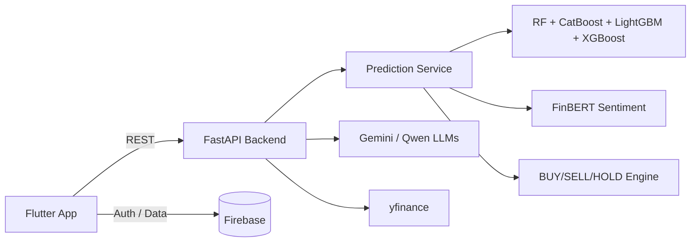

# QuantEdge

**Hybrid AI-Powered Financial Insight & Learning Platform for Young Investors**

## Project Overview

QuantEdge helps young and beginner investors understand the stock market. It combines a hybrid machine-learning ensemble, FinBERT news sentiment, and LLM-generated explanations with an adaptive learning path, so users see *what* the model suggests and *why*, at a depth matched to their experience. A FastAPI backend serves a cross-platform Flutter app.

## Features

- **Stock market analysis:** live market data via `yfinance`, searchable tickers and per-ticker detail views.
- **Hybrid ML ensemble:** Random Forest, CatBoost, LightGBM and XGBoost combined into one prediction.
- **BUY / SELL / HOLD decision engine:** converts ensemble probabilities into a signal using configurable thresholds.
- **FinBERT sentiment analysis:** live financial news sentiment (`ProsusAI/finbert`) used as a model input.
- **Explainable AI (XAI):** factor-impact breakdowns and natural-language explanations at five insight levels.
- **AI-powered learning and quizzes:** adaptive lessons, onboarding quiz, practice questions and level progression.
- **Portfolio management:** add and remove holdings and view portfolio metrics.
- **AI financial assistant:** educational chat assistant calibrated to the user's level.
- **Interactive Flutter dashboard:** Dashboard, Market, Portfolio, Quiz and Assistant tabs.

## Technology Stack

| Layer | Technologies |
|---|---|
| Frontend | Flutter / Dart, Provider, `http` |
| Backend | Python, FastAPI, Uvicorn, Pydantic |
| Machine Learning | scikit-learn (Random Forest), CatBoost, LightGBM, XGBoost, pandas, NumPy |
| NLP | FinBERT (`ProsusAI/finbert`) via Hugging Face Transformers, PyTorch |
| LLMs | Google Gemini (`google-genai`), Qwen via Groq (`groq`) |
| Database / Auth | Firebase Authentication, Cloud Firestore, Google Sign-In |
| Data / APIs | `yfinance` market data, Gemini API, Groq API |

## Architecture

The Flutter app talks to the FastAPI backend over REST. The backend runs the ML ensemble and decision engine on live market data plus FinBERT sentiment, and calls LLMs for explanations, lessons and assistant replies. Firebase handles authentication and user data directly from the app.



## Project Structure

```
QuantEdge/
├── backend/                  # FastAPI app (backend/src/routes/learningRoutes.py)
├── src/
│   ├── ml/                   # Ensemble, decision engine, saved models, prediction service
│   ├── sentimentanalysis/    # FinBERT sentiment scoring
│   ├── features/ , data/     # Feature engineering and datasets
│   ├── inference/            # Decision engine runner
│   └── learning/             # Learning engine modules
├── flutter_app/              # Flutter client (lib/screens, tabs, providers, services)
├── final finbert and llm sentiment analysis/   # Additional sentiment module (see below)
└── requirements.txt          # Main backend dependencies
```

## Installation and Execution

### Prerequisites

- Git
- Python 3.10+ and `pip`
- Flutter SDK (Dart `>=3.0.0 <4.0.0`)
- A [Gemini API key](https://aistudio.google.com/app/apikey) (required) and a Groq API key (used for Qwen explanations)

### 1. Clone the repository

```bash
git clone https://github.com/<your-username>/QuantEdge-.git
cd QuantEdge-
```

### 2. Backend setup

```bash
python -m venv venv
# Windows
venv\Scripts\activate
# macOS / Linux
source venv/bin/activate
```

> `requirements.txt` is saved in **UTF-16** encoding. If `pip` fails to read it, convert it to UTF-8 first.

```bash
pip install -r requirements.txt
```

### 3. Environment variables

```bash
cp backend/.env.example backend/.env      # Windows: copy backend\.env.example backend\.env
```

Edit `backend/.env`:

```env
GEMINI_API_KEY=your_gemini_api_key_here
GROQ_API_KEY=your_groq_api_key_here
```

`GEMINI_API_KEY` is listed in `.env.example`; `GROQ_API_KEY` is also read by the backend (`.env.example` does not list it). Never commit `.env`.

### 4. Firebase configuration

The Flutter app uses Firebase Authentication and Cloud Firestore. The repository ships with `flutter_app/lib/firebase_options.dart` and `flutter_app/android/app/google-services.json` for the existing Firebase project. To use your own project, create one in the [Firebase console](https://console.firebase.google.com/), enable Email/Password and Google sign-in plus Firestore, then regenerate the config:

```bash
dart pub global activate flutterfire_cli
cd flutter_app
flutterfire configure
cd ..
```

The backend does not require Firebase credentials.

### 5. Start the backend

From the repository root (with the virtual environment active):

```bash
uvicorn backend.src.routes.learningRoutes:app --reload --port 8000
```

API available at `http://127.0.0.1:8000` (interactive docs at `/docs`, health check at `/api/learning/health`).

### 6. Flutter setup

In a new terminal:

```bash
cd flutter_app
flutter pub get
```

### 7. API base URL

The base URL is hard-coded and selected by platform. No change is needed for local development:

| Platform | Base URL |
|---|---|
| Web, desktop, iOS simulator | `http://127.0.0.1:8000` |
| Android emulator | `http://10.0.2.2:8000` |

To use a physical device or remote server, update `baseUrl` in `flutter_app/lib/services/api_service.dart`, `learning_engine_service.dart` and `practice_service.dart`.

### 8. Run the Flutter app

```bash
flutter run
```

Choose a target when prompted, or specify one, e.g. `flutter run -d chrome`. Keep the backend running.

## Additional Sentiment Analysis Module

The folder `final finbert and llm sentiment analysis` is a **separate, additional module**. It is **not required** to launch the main application. It contains two approaches to financial news sentiment:

- **Gemini LLM-based** sentiment analysis of financial news.
- **FinBERT-based** sentiment analysis of financial news (baseline for comparison).

It has its own dependencies (`requirements-sentiment.txt`) and configuration (`.env.example`, including Gemini and Hugging Face settings). See `final finbert and llm sentiment analysis/src/sentiment/README.md` for details.

## Contributors / Collaborators
_[[Samruddhi Ambre](https://github.com/SamruddhiAmbre)]_ 
_[[Navya Goel](https://github.com/NavyaaaGoel)]_
_[[Shreya Tiwari](https://github.com/Coldnerdnacho)]_ 
_[[Disha Gaikwad](https://github.com/DishaGaikwad-9)]_


## Disclaimer

QuantEdge provides **educational financial insights only**. Its signals, explanations and sentiment scores are not guaranteed investment advice. Markets carry risk; do your own research or consult a licensed financial advisor before investing.
